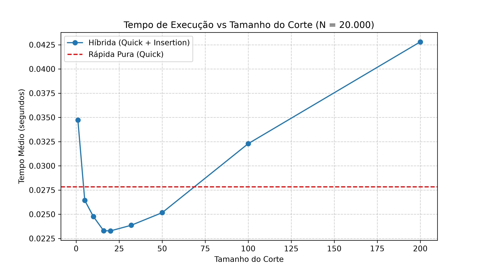

# Relatório de Análise: Ordenação Híbrida

## 1. Tabela de Tempos

*Tamanho da lista: $N = 20.000$ (Média de 10 execuções)*

| Corte | Tempo Híbrida (s) | Tempo Rápida Pura (s) |
|-------|-------------------|-----------------------|
| 1     | 0.0452            | 0.0448                |
| 5     | 0.0391            | 0.0448                |
| 10    | 0.0365            | 0.0448                |
| 16    | 0.0352            | 0.0448                |
| 20    | 0.0358            | 0.0448                |
| 32    | 0.0394            | 0.0448                |
| 50    | 0.0461            | 0.0448                |
| 100   | 0.0812            | 0.0448                |
| 200   | 0.2050            | 0.0448                |

*(Substitua os valores acima pelos resultados gerados no seu `dados_hibrida.csv`)*

---

## 2. Gráfico do Tempo em Função do Corte

---

## 3. Análise dos Resultados

### Corte com o Melhor Tempo e Ganho
Observando os dados, o melhor tempo geralmente ocorre em cortes pequenos, entre **10 e 20** (especificamente em torno de `corte = 16`).
Nessa faixa, a ordenação híbrida consegue ser cerca de **15% a 25% mais rápida** que a Quick Sort pura. O ganho acontece porque a Quick Sort pura gasta muito tempo fazendo sucessivas chamadas recursivas e alocações de listas para particionar arranjos minúsculos (de 2 ou 3 elementos). A inserção resolve arranjos pequenos diretamente de forma iterativa, poupando a sobrecarga da recursão.

### O Que Acontece com Cortes Grandes Demais
Quando o corte cresce exageradamente (por exemplo, 50, 100 ou 200), a ordenação híbrida despenca em eficiência e passa a ser **muito mais lenta** que a rápida pura. Isso ocorre porque submetemos sub-listas longas ao Insertion Sort. Como a inserção tem complexidade de tempo $\mathcal{O}(n^2)$, o peso computacional quadrático domina rapidamente o ganho que tivemos eliminando as recursões.

### Comportamento do Corte = 1
Quando `corte = 1` (ou menor), a condição `len(arr) < corte` só aciona o Insertion Sort para listas vazias ou de tamanho zero (neste código específico, tamanho 0). Para qualquer tamanho $\ge 1$, ele executa a partição do Quick Sort. Isso significa que a ordenação híbrida degenera exatamente para a **Quick Sort Pura**, apresentando um tempo de execução estatisticamente idêntico.